# 光何企业管理平台（gsite）

基于 Spring Boot 2.7 + Vue 3 的企业级后台管理系统，内置 15 个业务模块，覆盖系统管理、工作流、支付、商城、CRM、ERP、MES、WMS、HRM、FMS、IM、微信公众号、数据报表等场景。

- 仓库地址：<https://github.com/guangheUlti/gsite>
- 联系邮箱：18903378092@163.com

## 技术栈

| 分类 | 选型 | 版本 |
|---|---|---|
| 语言 | Java | 1.8 |
| 后端框架 | Spring Boot | 2.7.18 |
| 安全 | Spring Security + Token | 5.8.16 |
| ORM | MyBatis-Plus | 3.5.16 |
| 连接池 | Druid + Dynamic Datasource | 1.2.28 / 4.5.0 |
| 缓存 | Redis + Redisson | 5.0+ / 4.6.1 |
| 工作流 | Flowable | 6.8.1 |
| 接口文档 | Springdoc (Knife4j) | 1.8.0 |
| 前端 | Vue 3 + Element Plus + Vite | 3.5 / 8.x |
| 兼容数据库 | MySQL、Oracle、PostgreSQL、SQL Server、达梦、人大金仓、OpenGauss、HighGo | |

## 架构概览

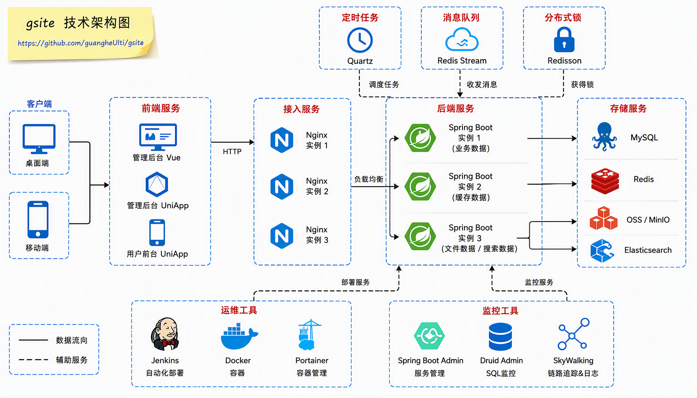

## 已启用模块

以下模块已在当前构建中启用并通过验证：

| 模块 | 说明 | 预览 |
|---|---|---|
| **系统管理** | 用户、角色、菜单、部门、岗位、字典、短信、邮件、站内信、OAuth2、日志 | 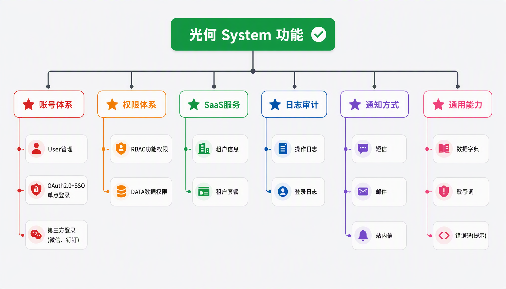 |
| **基础设施** | 代码生成、文件存储、定时任务、API 日志、数据库文档、WebSocket、系统更新 | 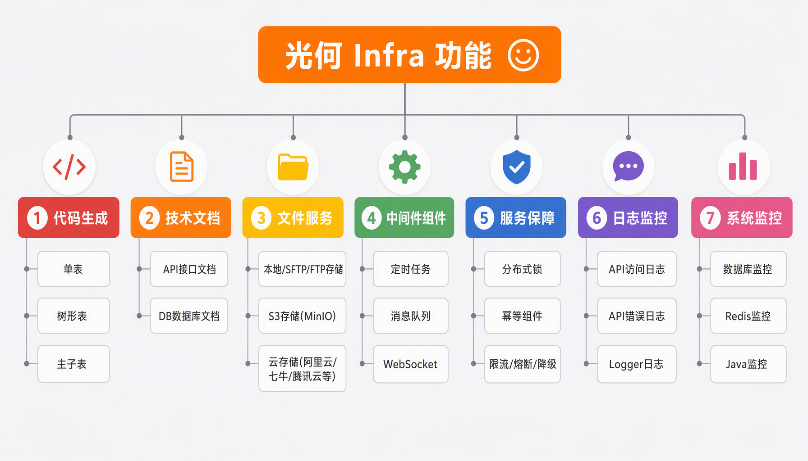 |
| **工作流程** | BPMN + 仿钉钉双设计器，会签/或签/加签/委派/超时审批等 | 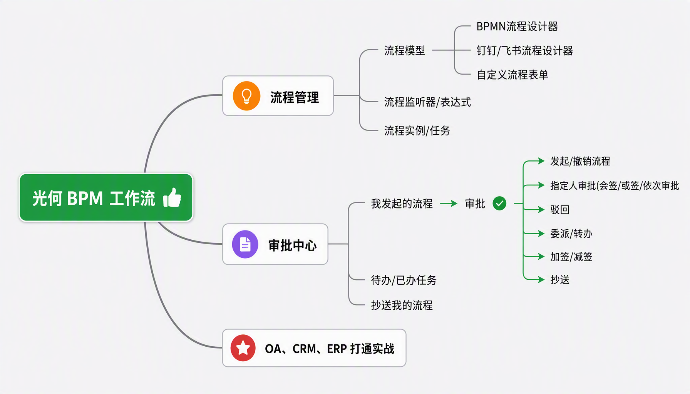 |
| **支付系统** | 应用管理、支付订单、退款订单、回调通知，对接支付宝/微信 | - |
| **会员中心** | 会员管理、标签、等级、分组、积分签到 | - |
| **商城系统** | 商品、营销（优惠券/秒杀/拼团）、交易、统计 |  |
| **CRM** | 客户、线索、商机、合同、回款、跟进记录 | 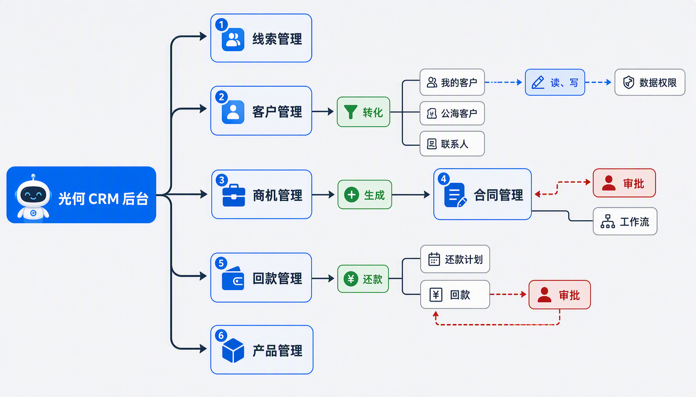 |
| **ERP** | 产品、采购、销售、库存、财务 | 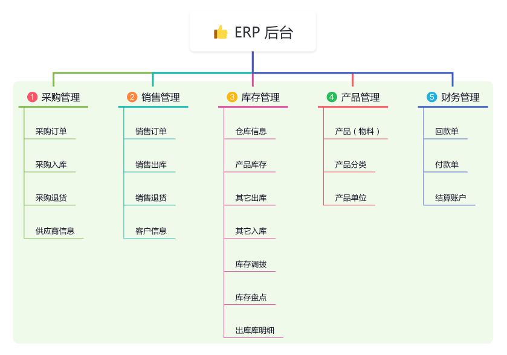 |
| **MES** | 排产、设备、工装、质量、生产、仓储 | 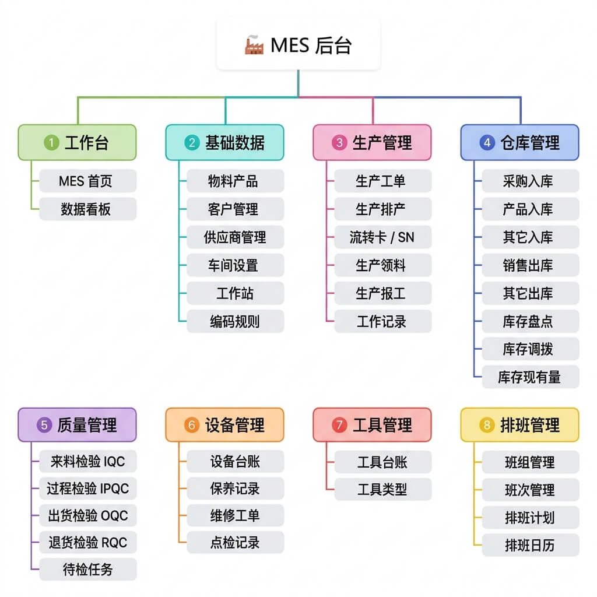 |
| **WMS** | 入库、出库、盘点、库存管理 | 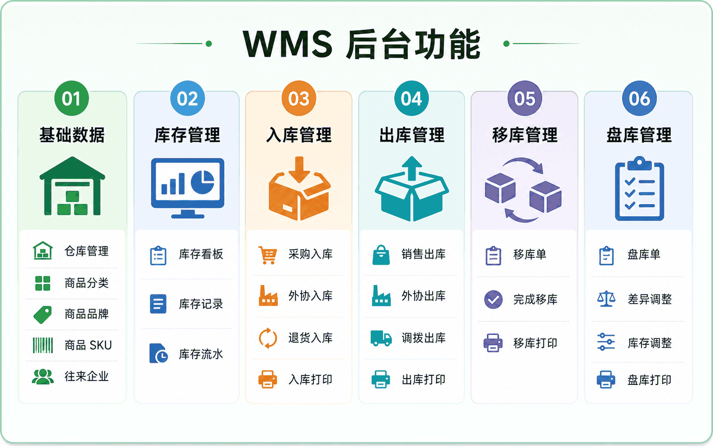 |
| **HRM** | 员工、考勤、薪资、招聘、绩效、社保 | 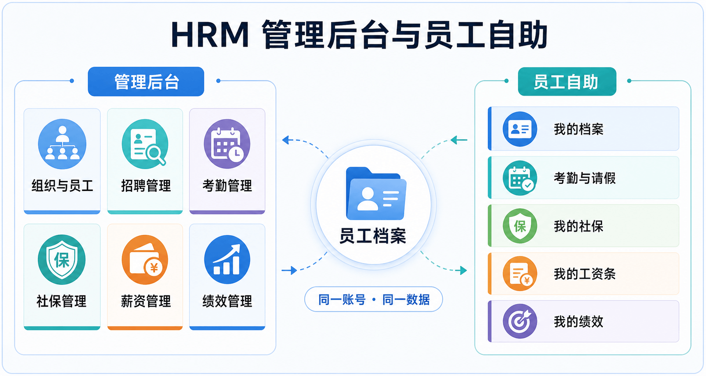 |
| **FMS** | 账簿、凭证、结账、财务报表 | 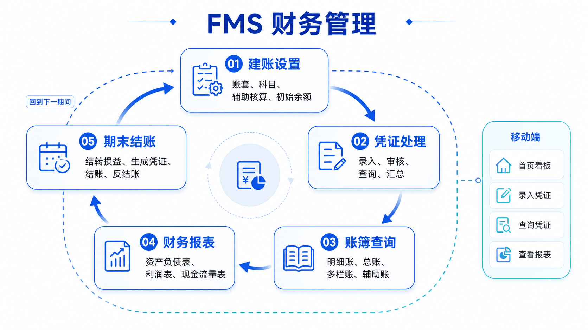 |
| **IM** | 即时通讯、聊天管理 | 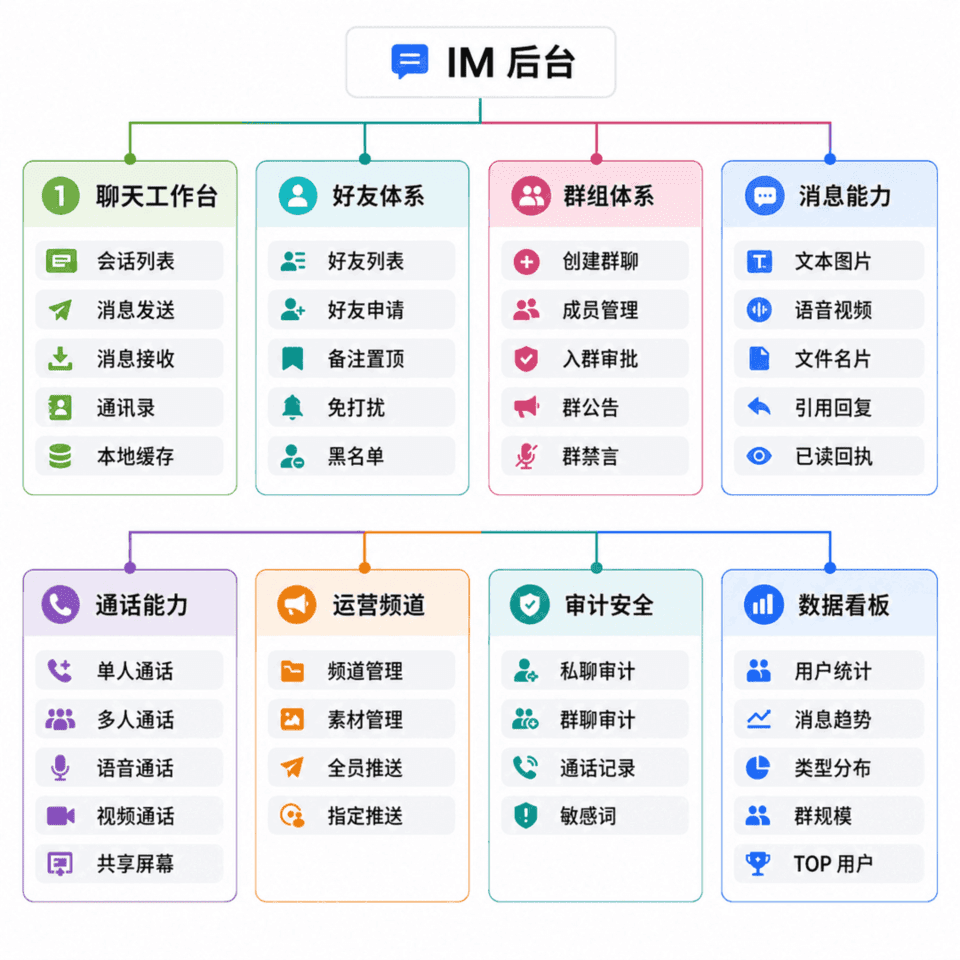 |
| **微信公众号** | 账号、粉丝、消息、自动回复、菜单、素材、图文 | - |
| **数据报表** | JimuReport 报表设计器 + GoView 大屏设计器 | - |

### 未启用模块

| 模块 | 原因 |
|---|---|
| AI 大模型 | 需要 JDK 17+，当前分支为 JDK 8 |
| IoT 物联网 | 需要 TDengine 时序数据库 |
| CMS 内容管理 | 无后端/前端代码实现 |

如需启用以上模块，请切换到对应分支或安装所需中间件后在 `pom.xml` 中取消注释。

## 目录结构

```
gsite/
├── guanghe-dependencies/              Maven BOM 依赖版本管理
├── guanghe-framework/                 15 个 Spring Boot Starter
├── guanghe-server/                    启动入口（可执行 jar）
├── guanghe-module-system/             系统管理
├── guanghe-module-infra/              基础设施
├── guanghe-module-bpm/                工作流程
├── guanghe-module-pay/                支付系统
├── guanghe-module-member/             会员中心
├── guanghe-module-mall/               商城（product/promotion/trade/statistics）
├── guanghe-module-crm/                CRM 客户关系
├── guanghe-module-erp/                ERP 企业资源
├── guanghe-module-mes/                MES 制造执行
├── guanghe-module-wms/                WMS 仓库管理
├── guanghe-module-hrm/                HRM 人力资源
├── guanghe-module-fms/                FMS 财务管理
├── guanghe-module-im/                 IM 即时通讯
├── guanghe-module-mp/                 微信公众号
├── guanghe-module-report/             数据报表
├── guanghe-ui/guanghe-ui-admin-vue3/  前端管理后台（Vue 3 + Element Plus）
├── sql/<方言>/gsite*.sql              建库脚本（MySQL/Oracle/PG/达梦/金仓等）
│   └── mysql/  gsite.sql（核心表+初始数据）
│               quartz.sql（定时任务）  gsite_modules.sql（393 张业务模块表）
├── release/gsite-deploy/              Windows 一体化部署包（见下方说明）
└── .image/                            README 截图与功能架构图
```

## 快速开始

### 开发环境

前置条件：JDK 8、Maven 3.x、MySQL 8、Redis 5.0+

启动顺序固定为：**① MySQL → ② Redis → ③ 后端**，每步各开一个终端窗口。

```bash
# ① 首次建库（只需做一次，三个脚本都要导入）
mysql -h 127.0.0.1 -uroot -proot -e "CREATE DATABASE IF NOT EXISTS gsite DEFAULT CHARACTER SET utf8mb4;"
mysql -h 127.0.0.1 -uroot -proot --default-character-set=utf8mb4 gsite < sql/mysql/gsite.sql
mysql -h 127.0.0.1 -uroot -proot --default-character-set=utf8mb4 gsite < sql/mysql/quartz.sql
mysql -h 127.0.0.1 -uroot -proot --default-character-set=utf8mb4 gsite < sql/mysql/gsite_modules.sql
# 导入后共 452 张表：48 核心 + 11 Quartz + 393 业务模块
# Flowable 的 act_* / flw_* 表无需手工导入，后端首次启动时自动创建

# ② 启动 MySQL（或双击 D:\devTools\mysql\start.bat）
cd /d D:\devTools\mysql && bin\mysqld.exe --console
# 验证：bin\mysqladmin.exe -h 127.0.0.1 -uroot -proot ping → mysqld is alive

# ③ 启动 Redis（或双击 D:\devTools\redis\start.bat）
cd /d D:\devTools\redis && redis-server.exe redis.conf
# 验证：redis-cli.exe ping → PONG

# ④ 构建（仅首次或代码变更后）
set JAVA_HOME=D:\devTools\jdk\jdk1.8.0_202
mvn -B -T1C clean install -DskipTests

# ⑤ 启动后端（端口 48080，约 30 秒）
java -jar guanghe-server/target/guanghe-server.jar --spring.profiles.active=local
# 看到 "Started GuangheServerApplication in XX seconds" 即成功
```

**停止服务：**
- 后端 / Redis：关闭终端窗口或 Ctrl+C；也可用 `stop.bat`
- MySQL 建议优雅关闭：`bin\mysqladmin.exe -h 127.0.0.1 -uroot -proot shutdown`

### 生产部署（Windows 一体化包）

`release/gsite-deploy.zip` 是自包含部署包，内置 JRE + MySQL + Redis + nginx，无需预装任何软件：

1. 解压到目标服务器（路径不含空格/中文）
2. 编辑 `config.bat` 修改端口和密码
3. 双击 `init.bat` 完成初始化
4. 双击 `start-all.bat` 启动全部服务

详见 `release/gsite-deploy/README.md`。

## 访问地址

| 用途 | 地址 |
|---|---|
| 管理后台 | http://127.0.0.1 （nginx 代理） |
| 接口文档（Knife4j） | http://127.0.0.1:48080/doc.html |
| OpenAPI JSON | http://127.0.0.1:48080/v3/api-docs |
| Druid 连接池监控 | http://127.0.0.1:48080/druid/index.html |
| API 前缀 | `/admin-api/` |

## 默认账号

| 账号 | 密码 | 说明 |
|---|---|---|
| admin | admin | 超级管理员 |

> 首次部署后请及时修改默认密码。

## 配置说明

- 核心配置：`guanghe-server/src/main/resources/application.yaml`
- 本地开发：`application-local.yaml`
- 生产部署：由 `release/gsite-deploy/templates/` 模板自动生成
- 模块开关：在根 `pom.xml` 和 `guanghe-server/pom.xml` 中注释/取消注释对应模块

> **安全提醒**：`local` 环境开启了 Mock 模式（`guanghe.security.mock-enable: true`），Druid 监控台未设密码。本机开发无碍，**对外部署前必须关闭 Mock 并设置 Druid 账号密码**。
>
> **MySQL 字符集**：建议 `my.ini` 中使用 `character-set-server=utf8mb4` + `collation-server=utf8mb4_unicode_ci`，避免 emoji 等 4 字节字符存储失败。业务表需统一为 `utf8mb4_unicode_ci`：混用排序规则会让跨表 `JOIN` / `UNION` 报 `Illegal mix of collations`（MES 待检清单即为一例）。
>
> **其他方言**：`gsite_modules.sql` 目前仅提供 MySQL 版。Oracle / PostgreSQL / 达梦 / 金仓 / OpenGauss / HighGo / SQL Server 下，业务模块表尚未转换，对应菜单会因缺表报错，需先按 `sql/<方言>/gsite.sql` 的语法转换后再使用。

## 演示截图

| 登录页 | 首页 |
|---|---|
| 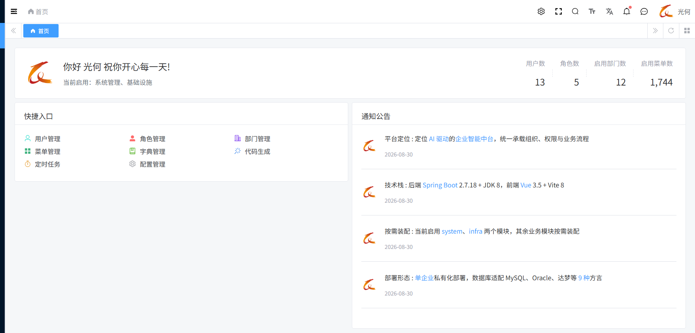 | 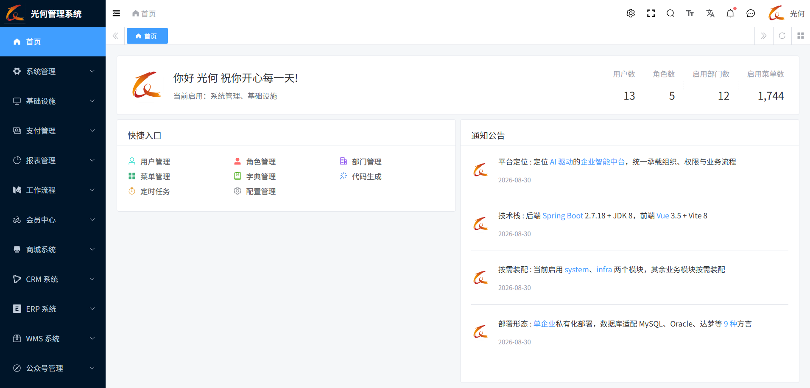 |

| 用户管理 | 菜单管理 | 角色管理 |
|---|---|---|
| 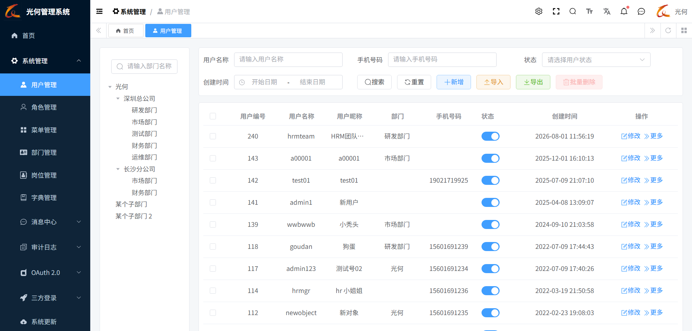 | 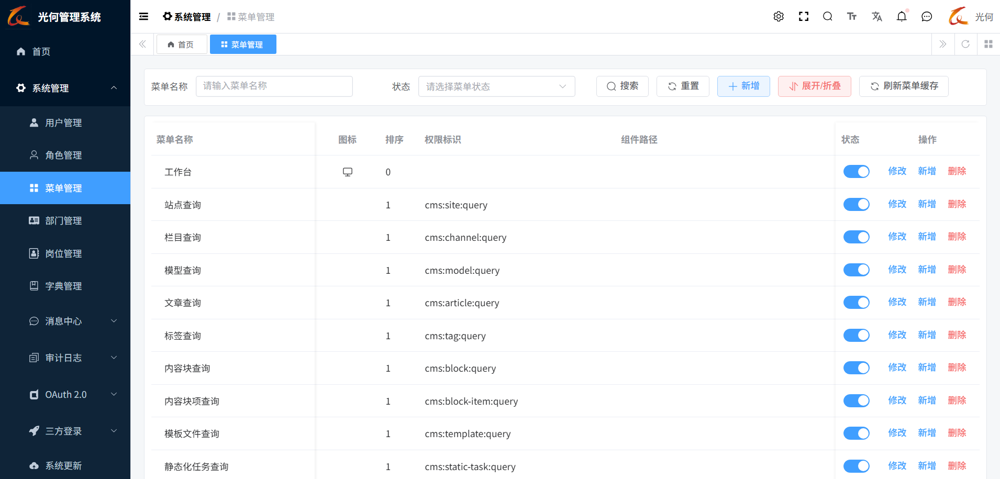 | 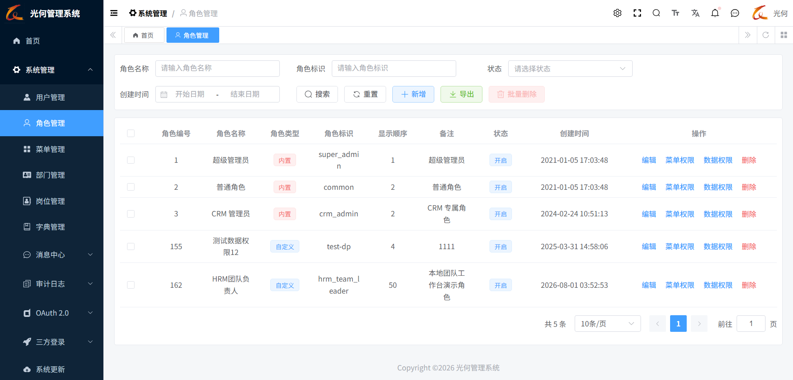 |

| 代码生成 | 配置管理 | 定时任务 |
|---|---|---|
| 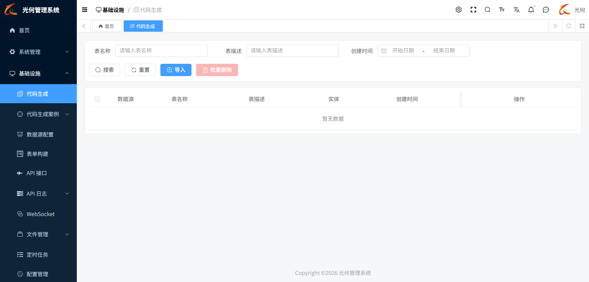 | 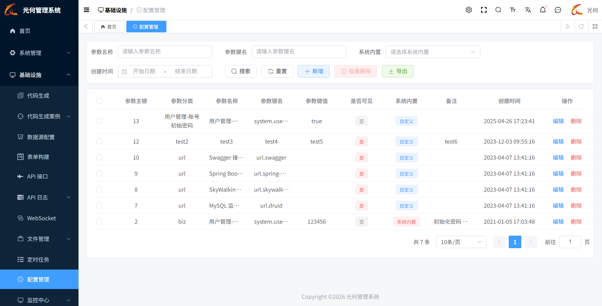 | 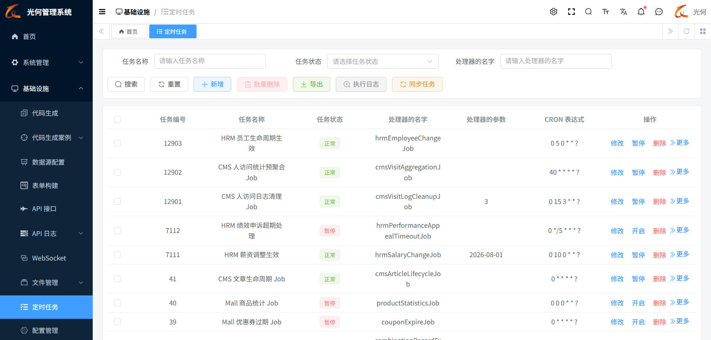 |

更多截图见 `.image/` 目录。

## 许可

本项目基于 MIT License 开源。
